# TEKKVIN Backend

**API REST para una tienda en línea de productos tecnológicos**

---

## Contenido

1. [Información del proyecto](#1-información-del-proyecto)
2. [Modelo Entidad-Relación (DER)](#2-modelo-entidad-relación-der)
3. [Diccionario de Datos (DD)](#3-diccionario-de-datos-dd)
4. [Historial de commits en `master`](#4-historial-de-commits-en-master)

---

## 1. Información del proyecto

| | |
|---|---|
| **Título** | TEKKVIN Backend |
| **Siglas** | TEKKVIN <!-- Completar el significado de las siglas --> |
| **Repositorio** | [IbenFlores/tekkvin-backend](https://github.com/IbenFlores/tekkvin-backend) |
| **Rama principal** | `master` |
| **Stack** | Python · Django 6.1 · Django REST Framework · Supabase |

### Participantes

| Integrante | GitHub |
|---|---|
| Iben Flores | [@IbenFlores](https://github.com/IbenFlores) |
| Kevin Chambilla | [@kevins2417](https://github.com/kevins2417) |
| Cinthia Blanco | [@Cinthia0709](https://github.com/Cinthia0709) |
| Lucia Luna | [@Lunaal](https://github.com/Lunaal) |

### Descripción

TEKKVIN Backend es la capa de servicios de una tienda en línea de productos tecnológicos. Expone una API REST que cubre cuatro módulos:

| Módulo | Funcionalidad |
|---|---|
| **Autenticación** | Registro e inicio de sesión de usuarios con token. |
| **Catálogo** | Listado y detalle de productos, con filtros por categoría y marca. |
| **Carrito** | Creación del carrito, y alta, modificación y baja de ítems. |
| **Pedidos** | Creación y consulta de pedidos con control de stock, y cancelación con reposición de stock. |

Además, el panel de administración de Django (`/admin/`) tiene registrados los 11 modelos del sistema. Al guardar desde el panel se completan automáticamente los campos de auditoría (`created_id` y `modified_id`) con el usuario autenticado.

### Tecnología utilizada

| Ítem | Tecnología |
|---|---|
| **Desarrollo** | Git |
| | GitHub |
| **Backend** | Python |
| | Django 6.1 |
| | Django REST Framework |
| | python-dotenv |
| **BD** | Supabase |
| **Pruebas** | Django `TestCase` y DRF `APITestCase` |

### Endpoints principales

| Método | Ruta | Descripción |
|---|---|---|
| `POST` | `/api/auth/register/` | Registro de usuario |
| `GET` | `/api/products/` | Listado de productos (`?category=`, `?brand=`) |
| `POST` | `/api/carritos/<id>/items/` | Agregar un ítem al carrito |
| `POST` | `/api/pedidos/` | Crear un pedido a partir de un carrito |

### Ejemplos de uso

**Registro de usuario** · `POST /api/auth/register/`

```json
{
  "first_name": "Ana",
  "last_name": "Torres",
  "email": "ana@example.com",
  "password": "ClaveSegura#2026"
}
```

Respuesta `201 Created`:

```json
{ "token": "<token>", "user_id": 1, "email": "ana@example.com" }
```

**Listado de productos** · `GET /api/products/?category=1&brand=2`

```json
[
  {
    "id": 1,
    "sku": "LAP-001",
    "name": "Laptop",
    "sale_price": "2500.00",
    "current_stock": 10,
    "is_active": true,
    "category": { "id": 1, "name": "Computadoras" },
    "brand": { "id": 2, "name": "Marca" }
  }
]
```

**Agregar ítem al carrito** · `POST /api/carritos/1/items/`

```json
{ "product_id": 1, "quantity": 2 }
```

Respuesta `201 Created`:

```json
{
  "id": 1,
  "customer_id": 1,
  "active": true,
  "items": [
    { "id": 1, "product_id": 1, "name": "Laptop", "quantity": 2, "unit_price": "2500.00", "subtotal": "5000.00" }
  ],
  "total": "5000.00"
}
```

**Crear pedido** · `POST /api/pedidos/`

```json
{ "cart_id": 1 }
```

Respuesta `201 Created`:

```json
{
  "id": 1,
  "customer_id": 1,
  "status": "registrado",
  "total": "5000.00",
  "items": [
    { "id": 1, "product_id": 1, "name": "Laptop", "quantity": 2, "unit_price": "2500.00", "subtotal": "5000.00" }
  ]
}
```

**Códigos de respuesta:** `200` correcto · `201` recurso creado · `400` datos inválidos (cuerpo `{ "error": "mensaje" }`) · `404` recurso no encontrado.

### Reglas de negocio

**Registro y sesión**
- El registro crea la cuenta de usuario y el cliente (`customers`) en una sola transacción.
- El correo no puede repetirse entre usuarios ni entre clientes, y se normaliza a minúsculas.
- La contraseña se valida con los validadores de contraseñas de Django.

**Carrito**
- Solo se puede crear un carrito para un cliente activo.
- Si se agrega un producto que ya está en el carrito, las cantidades se acumulan en un único ítem.
- Un producto solo puede agregarse si está activo, tiene un precio válido y hay stock suficiente para la cantidad pedida.
- Un carrito confirmado o cerrado no admite más cambios.

**Pedidos**
- Un pedido se crea a partir de un carrito activo, con un cliente activo y al menos un ítem.
- La operación es atómica: bloquea el carrito y los productos, valida el stock, descuenta `current_stock`, registra los ítems con el precio vigente y cierra el carrito. Si algo falla, no se guarda ningún cambio.
- Al cancelar un pedido se marca como cancelado y se repone el stock de cada ítem. No se puede cancelar un pedido ya cancelado ni uno que tenga una venta asociada.
- El listado de pedidos se pagina de 20 en 20 y puede filtrarse por cliente.

### Estructura del proyecto

```text
tekkvin-backend/
├── .DS_Store
├── requirements.txt                      # Dependencias del proyecto
└── tekkvin_project/
    ├── .DS_Store
    ├── manage.py                         # Utilidad de línea de comandos de Django
    ├── tekkvin_project/                  # Configuración del proyecto
    │   ├── __init__.py
    │   ├── asgi.py                       # Punto de entrada ASGI
    │   ├── settings.py                   # Configuración (base de datos, apps, idioma)
    │   ├── urls.py                       # Rutas principales (admin, auth, productos)
    │   └── wsgi.py                       # Punto de entrada WSGI
    └── apps/
        └── store/                        # Aplicación principal
            ├── __init__.py
            ├── admin.py                  # Panel de administración con auditoría
            ├── api_common.py             # Validaciones y manejo de errores compartidos
            ├── apps.py                   # Configuración de la app
            ├── cart_views.py             # Endpoints del carrito
            ├── order_views.py            # Endpoints de pedidos
            ├── views.py                  # Endpoints de autenticación y catálogo
            ├── serializers.py            # Serializers de registro, login y catálogo
            ├── urls.py                   # Rutas de carrito y pedidos
            ├── tests.py                  # Pruebas de autenticación y catálogo
            ├── tests_shopping_api.py     # Pruebas de carrito y pedidos
            ├── models.py.deprecated      # Archivo de modelos anterior (en desuso)
            ├── models/                   # Un modelo por archivo
            │   ├── __init__.py
            │   ├── Brand.py
            │   ├── Cart.py
            │   ├── CartItem.py
            │   ├── Category.py
            │   ├── Customer.py
            │   ├── Order.py
            │   ├── OrderItem.py
            │   ├── Product.py
            │   ├── ProductSupplier.py
            │   ├── Sale.py
            │   └── Supplier.py
            └── migrations/
                ├── __init__.py
                ├── 0001_initial.py
                ├── 0002_cart_customer_supplier_cartitem_cart_customer_order_and_more.py
                ├── 0003_rename_create_id_brand_created_id_and_more.py
                ├── 0004_orderitem_created_orderitem_created_id_and_more.py
                └── 0005_alter_cartitem_quantity_alter_customer_email_and_more.py
```

### Instalación y ejecución

**Requisitos:** Python 3 y acceso a una base de datos en Supabase.

```bash
git clone https://github.com/IbenFlores/tekkvin-backend.git
cd tekkvin-backend
pip install -r requirements.txt
```

Crear `tekkvin_project/.env` con las credenciales de la base de datos:

```env
SUPABASE_DATABASE_HOST=
SUPABASE_DATABASE_PORT=
SUPABASE_DATABASE_NAME=
SUPABASE_DATABASE_USER=
SUPABASE_DATABASE_PASSWORD=
```

```bash
cd tekkvin_project
python manage.py migrate
python manage.py runserver
```

La API queda disponible en `http://127.0.0.1:8000/api/`.

### Pruebas

```bash
python manage.py test apps.store
```

| Archivo | Qué cubre |
|---|---|
| `tests.py` | Registro (cuenta, cliente y token), inicio de sesión, listado de productos con filtros por categoría y marca, y detalle de producto. |
| `tests_shopping_api.py` | Compra y cancelación con reposición de stock, actualización y eliminación de ítems del carrito, reversión por stock insuficiente, validación de datos de entrada y acceso sin sesión ni CSRF. |

---

## 2. Modelo Entidad-Relación (DER)



---

## 3. Diccionario de Datos (DD)

Leyenda: **PK** clave primaria · **FK** clave foránea · **UK** valor único · **NN** obligatorio.

### Columnas de auditoría (comunes)

Todas las tablas incluyen estas columnas, salvo que se indique lo contrario.

| Columna | Tipo | Descripción |
|---|---|---|
| `status` | boolean | Estado lógico del registro (por defecto `true`). No existe en `order_item` ni en `sale`. |
| `created` | timestamp | Fecha de creación (automática). |
| `modified` | timestamp | Fecha de última modificación (automática). |
| `created_id` | integer | Identificador del usuario que creó el registro. |
| `modified_id` | integer | Identificador del usuario que modificó el registro. |

### `categories`

| Columna | Tipo | Restricción | Descripción |
|---|---|---|---|
| `id` | integer | PK | Identificador |
| `name` | varchar(255) | | Nombre de la categoría |
| `description` | varchar(255) | | Descripción |
| `parent_category_id` | integer | FK → `categories` | Categoría padre |

### `brands`

| Columna | Tipo | Restricción | Descripción |
|---|---|---|---|
| `id` | integer | PK | Identificador |
| `name` | varchar(255) | | Nombre de la marca |
| `support_url` | varchar(255) | | URL de soporte |

### `products`

| Columna | Tipo | Restricción | Descripción |
|---|---|---|---|
| `id` | integer | PK | Identificador |
| `sku` | varchar(255) | UK | Código del producto |
| `name` | varchar(255) | | Nombre |
| `technical_specifications` | json | | Especificaciones técnicas |
| `sale_price` | decimal(10,2) | | Precio de venta |
| `current_stock` | integer | | Stock actual |
| `minimum_stock` | integer | | Stock mínimo |
| `is_active` | boolean | | Producto visible en el catálogo |
| `category_id` | integer | FK → `categories` | Categoría |
| `brand_id` | integer | FK → `brands` | Marca |

### `suppliers`

| Columna | Tipo | Restricción | Descripción |
|---|---|---|---|
| `id` | integer | PK | Identificador |
| `company_name` | text | | Razón social |
| `tax_id` | text | UK | Identificación tributaria |
| `contact_email` | text | | Correo de contacto |
| `phone` | text | | Teléfono |

### `product_suppliers`

| Columna | Tipo | Restricción | Descripción |
|---|---|---|---|
| `id` | integer | PK | Identificador |
| `product_id` | integer | FK → `products` | Producto |
| `supplier_id` | integer | FK → `suppliers` | Proveedor |
| `purchase_price` | decimal(10,2) | | Precio de compra |
| `estimated_delivery_days` | integer | | Días estimados de entrega |

Restricción única compuesta: (`product_id`, `supplier_id`).

### `customers`

| Columna | Tipo | Restricción | Descripción |
|---|---|---|---|
| `id` | integer | PK | Identificador |
| `first_name` | varchar(255) | NN | Nombres |
| `last_name` | varchar(255) | NN | Apellidos |
| `email` | varchar(255) | UK, NN | Correo electrónico |

### `carts`

| Columna | Tipo | Restricción | Descripción |
|---|---|---|---|
| `id` | integer | PK | Identificador |
| `customer_id` | integer | FK → `customers` | Cliente propietario |

### `cart_items`

| Columna | Tipo | Restricción | Descripción |
|---|---|---|---|
| `id` | integer | PK | Identificador |
| `cart_id` | integer | FK → `carts` | Carrito |
| `product_id` | integer | FK → `products` | Producto |
| `quantity` | integer | | Cantidad |

### `orders`

| Columna | Tipo | Restricción | Descripción |
|---|---|---|---|
| `id` | integer | PK | Identificador |
| `customer_id` | integer | FK → `customers` | Cliente |
| `total_amount` | decimal(12,2) | NN | Monto total |

### `order_item`

| Columna | Tipo | Restricción | Descripción |
|---|---|---|---|
| `id` | integer | PK | Identificador |
| `order_id` | integer | FK → `orders`, NN | Pedido |
| `product_id` | integer | FK → `products`, NN | Producto |
| `quantity` | integer | NN | Cantidad |
| `unit_price` | decimal(10,2) | NN | Precio unitario |
| `subtotal` | decimal(12,2) | NN | Subtotal |

### `sale`

| Columna | Tipo | Restricción | Descripción |
|---|---|---|---|
| `id` | integer | PK | Identificador |
| `order_id` | integer | FK → `orders`, NN | Pedido asociado |
| `issued_at` | timestamp | | Fecha de emisión |
| `receipt_type` | varchar(255) | NN | Tipo de comprobante |
| `receipt_number` | varchar(255) | UK, NN | Número de comprobante |
| `payment_status` | varchar(255) | NN | Estado del pago |
| `payment_method` | varchar(255) | NN | Método de pago |
| `tax_base` | decimal(12,2) | NN | Base imponible |
| `tax_amount` | decimal(12,2) | NN | Impuesto |
| `total_amount` | decimal(12,2) | NN | Total |

### Migraciones

| Migración | Contenido |
|---|---|
| `0001_initial` | Crea las tablas `brands`, `categories` y `products`. |
| `0002_cart_customer_supplier_...` | Crea `carts`, `customers`, `suppliers`, `cart_items`, `orders`, `order_item`, `sale` y `product_suppliers`. |
| `0003_rename_create_id_brand_created_id_...` | Renombra `create_id` a `created_id` en las tablas que lo tenían. |
| `0004_orderitem_created_orderitem_created_id_...` | Agrega campos de auditoría a `order_item`. |
| `0005_alter_cartitem_quantity_alter_customer_email_...` | Agrega validadores y restricciones `CHECK` (precios, stock, cantidades e importes no negativos) y valida el formato de los correos. |

---

## 4. Historial de commits en `master`

Se listan únicamente los commits más importantes de la rama principal, en orden cronológico.

### Inicialización del backend TEKKVIN

Creación del proyecto Django y de la app `store`, con los 11 modelos del dominio, la migración inicial y el registro de los modelos en el panel de administración.


---

### Conexión a Supabase

Conexión del proyecto a la base de datos en Supabase mediante variables de entorno, con nuevas migraciones y ajustes en los modelos y en el panel de administración.


---

### Carrito de compras y pedidos

Endpoints para gestionar el carrito de compras y los pedidos, con control de stock (descuento al crear el pedido y reposición al cancelarlo) y pruebas del flujo de compra.


---

### Autenticación y catálogo de productos

Registro e inicio de sesión de usuarios, y listado y detalle de productos con filtros por categoría y marca, junto con sus pruebas unitarias.


---

### Validaciones de datos y mejoras del administrador

Validaciones en los modelos para precios, stock, cantidades, importes y correos electrónicos, restricciones `CHECK` en la base de datos y mejoras en el panel de administración, como el filtro por estado.

